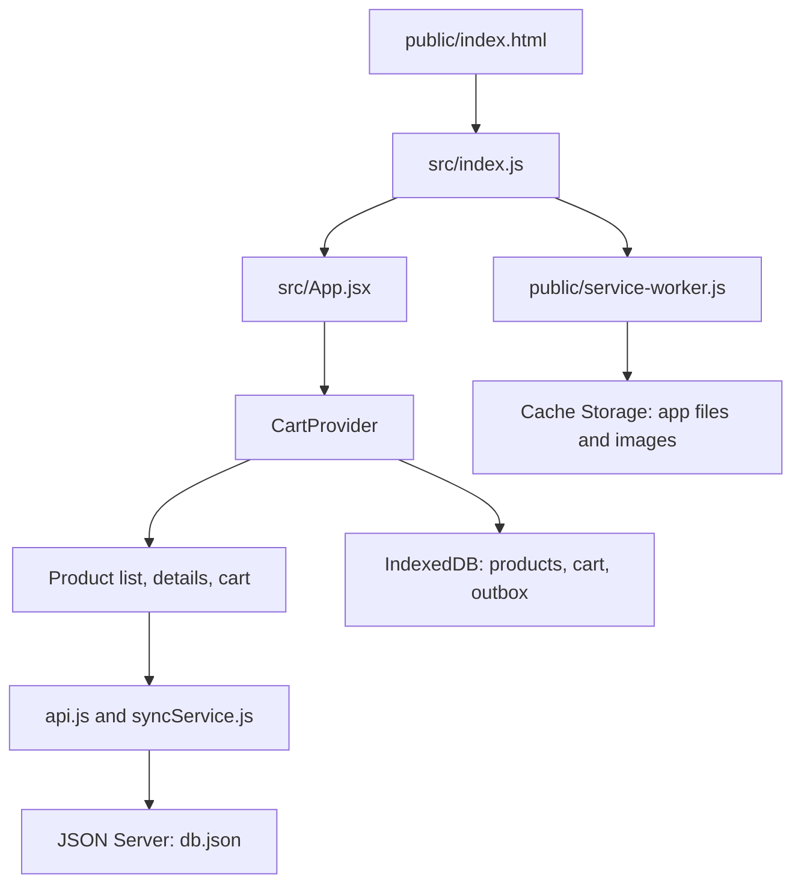

# Complete App Walkthrough

This guide explains how the Common Room furniture store is put together. It is written for someone learning React and Progressive Web Apps (PWAs), so it follows the app from page startup through offline cart synchronization.

## What the App Does

- Loads furniture products from JSON Server.
- Shows a product list, product details, and a cart.
- Saves products and cart changes in the browser so they remain available offline.
- Queues cart changes while offline, then sends them to JSON Server after reconnecting.
- Caches the website files and product photos with a service worker.

The app has two kinds of offline support: the service worker caches files that make the website run; IndexedDB stores app data such as products and cart changes.

## Start the App

Install packages once:

```bash
npm install
```

Run the backend and frontend in separate terminals:

```bash
npm run server
npm start
```

The React development server is normally at `http://localhost:3000`. JSON Server listens at `http://localhost:5000`. If port 5000 is already in use, use the JSON Server that is already running or configure another port and match it in the frontend API URL.

## How the Main Pieces Fit Together



## 1. Browser Startup and React

The browser opens `public/index.html`. Its `<div id="root"></div>` is the empty element where React will put the app. It also links the web app manifest, which supplies the installed app's name, theme color, and icons.

`src/index.js` is the JavaScript entry point. It:

1. Imports the global CSS and the root `App` component.
2. Registers `/service-worker.js` after the page `load` event if the browser supports service workers.
3. Creates a React root and renders `<App />` inside `React.StrictMode`.

`React.StrictMode` helps expose some programming mistakes during development. It does not create a separate production feature.

The service-worker registration call is separate from React rendering: registration tells the browser which worker to install; the worker's own file defines how requests are handled.

## 2. App Shell, Routes, and Shared State

`src/App.jsx` is the app shell. `CartProvider` wraps the router and makes shared cart and network state available to the screens. `BrowserRouter` reads the browser URL, and `Routes` selects a page:

| URL | Component | Purpose |
| --- | --- | --- |
| `/` | `ProductList` | Featured furniture and product grid |
| `/products/:productId` | `ProductDetails` | One product, selected by its ID |
| `/cart` | `CartPage` | Cart contents, quantity controls, and sync state |
| Any other path | `Navigate` | Return to the product list |

`Header` reads the shared cart to show the item count. It also renders `SyncIndicator`, which shows `Online`, `Offline`, a pending count, or `Syncing...`.

`src/context/CartContext.jsx` is a React Context. Context is useful here because the product list, product details, header, and cart all need access to the same cart state. Without it, each screen would need to pass the cart through several layers of component props.

## 3. Product List and Details

`src/pages/ProductList.jsx` reads `products`, `addToCart`, and `isReady` from `useCart()`. While local startup is being restored it displays a loading message. Once ready, it maps the product array into `ProductCard` components.

`src/components/ProductCard.jsx` receives one product and an `onAdd` function as props. It displays the image, category, name, and price. Product links navigate to `/products/<id>`; the **Add to cart** button calls `onAdd(product)`.

`src/pages/ProductDetails.jsx` reads `productId` from the route using `useParams()`, then finds that product in the shared product list. It can add the product and navigate to `/cart` with `useNavigate()`.

Prices are formatted by `Intl.NumberFormat` using the Indian rupee currency (`INR`). This formatting is display-only; the numeric price remains in the product record.

## 4. Cart Context and Browser Connectivity

When `CartProvider` mounts, it initializes the online state from `navigator.onLine`, then subscribes to the browser's `online` and `offline` events. These events update the shared `isOnline` state and the status shown in the header and cart.

The context then restores local products, cart items, and queued changes from IndexedDB. `isReady` becomes true after this restore attempt, so pages know when local startup has finished.

When online, another effect calls `fetchProducts()`. Successful product responses are saved locally before updating the UI. If the API request fails, the context keeps the cached catalog rather than discarding it.

The context also exposes three cart operations:

- `addToCart(product)` finds the current quantity and saves the new quantity.
- `updateQuantity(productId, quantity)` saves the requested quantity; zero removes the item from the visible local cart.
- `removeFromCart(productId)` records a desired quantity of zero, so the server can delete the item later.

Each operation updates the UI from the local database result, then refreshes the pending count from the outbox.

## 5. IndexedDB: Products, Cart, and Outbox

`src/db/indexedDB.js` creates a database called `form-field-store` with three object stores:

| Object store | Key | Contents |
| --- | --- | --- |
| `products` | `id` | Last successfully fetched catalog |
| `cart` | `productId` | Current local cart and its `pending`/`synced` status |
| `outbox` | `productId` | Latest desired quantity to send to the server |

An object store is similar to a small browser-side table. The `idb` package provides a Promise-based API on top of IndexedDB.

`saveCartItem` writes the cart and outbox changes in one read/write transaction. The outbox record includes a `revision` number. If a user changes a quantity again while a sync is in progress, that revision helps prevent an older response from clearing the newer queued change.

When IndexedDB is unavailable, the module stores equivalent arrays in `localStorage`. This is a fallback. IndexedDB is the normal storage path.

## 6. API and JSON Server

`src/services/api.js` wraps `fetch` calls and uses `http://localhost:5000` by default. `REACT_APP_API_URL` can override that base URL.

Products come from `GET /products`. The cart is stored in the `cart` collection in `db.json`. To sync a product, `syncCartItem` first queries matching rows:

- Desired quantity `0`: delete matching server rows.
- A matching row exists and quantity is above `0`: update it with `PATCH` and delete any duplicates.
- No matching row exists and quantity is above `0`: create it with `POST`.

This is an upsert-style operation: the server should end up matching the latest desired local cart state, rather than receiving every intermediate button click.

## 7. Reconnect and Sync Status

`src/services/syncService.js` reads all outbox records and processes them one by one. It calls `syncCartItem(change)` and, only after the API call succeeds, calls `markCartItemSynced(change)`.

`CartContext` starts this work when all of the following are true:

- Local startup has finished (`isReady`).
- The browser is online (`isOnline`).
- At least one outbox record exists (`pendingCount > 0`).
- A sync is not already running (`syncInProgress.current` is false).

After sync, the context reloads the local cart and queue count. If a request fails, the error is caught and the outbox record is retained for a later reconnect or page load.

`src/components/CartItem.jsx` displays each item's status. `src/components/SyncIndicator.jsx` displays the overall connection/sync status. `src/services/cartService.js` calculates the cart total from `price * quantity`.

## 8. Service Worker: File Caching

`public/service-worker.js` is separate from the React source. Its cache currently has the name `form-field-store-v4`.

- **Install:** Cache the app shell and all product images, discover script/style URLs from the HTML, and cache those assets.
- **Activate:** Remove older caches named `form-field-*`, then claim open app pages.
- **Fetch:** For page navigation, try network first and fall back to cached HTML. For product images, try cache first. For other same-origin `GET` files, try network first and fall back to cache.

The worker only handles same-origin `GET` requests. The backend uses port 5000 while the app uses another port, so API requests are not intercepted by the app's service worker. This is intentional: it avoids serving stale cart API data. Cart data is handled locally through IndexedDB instead.

For a deeper, service-worker-only walkthrough, see [service-worker-walkthrough.md](service-worker-walkthrough.md).

## 9. Offline Test Walkthrough

Do one online visit first. The worker must install, and the app must fetch products at least once so the catalog is stored locally.

1. Open browser DevTools and select **Network → Offline**.
2. Reload the page. The service worker should supply the app shell, scripts, styles, and photos from Cache Storage.
3. The React app restores products and cart from IndexedDB.
4. Add a product or change its quantity. The local cart updates and the outbox gets a pending change.
5. Open the cart and confirm the item says **Yet to sync**.
6. Select **No throttling** to reconnect. The browser's `online` event triggers the sync effect.
7. After JSON Server accepts the change, the outbox record is removed and the item says **Synced**.

Use **Network → Offline** for the full cart demo because it changes browser connectivity and fires the `offline`/`online` events the app listens to. The Application panel is useful to inspect service-worker registration and Cache Storage. For more details on the cart queue, see [offline-cart-flow.md](offline-cart-flow.md).

## 10. Testing and Current Limits

Run the automated test with:

```bash
npm test -- --watchAll=false
```

The test uses mocked API responses, simulates browser offline/online events, checks that the cart item stays pending offline, and verifies that it becomes synced after reconnecting. It does not test the browser's actual service-worker cache; use DevTools for that manual part.

This is a learning/demo app. The first visit must be online to fetch the initial product catalog and install the service worker. Checkout and payment are not implemented. `navigator.onLine` is a connectivity hint; an online browser does not guarantee that the JSON Server API is reachable.

## Important Files at a Glance

- `public/index.html`: HTML entry point and manifest link.
- `public/manifest.json`: install name, icons, and display settings.
- `public/service-worker.js`: offline cache and request fallback rules.
- `src/index.js`: React entry point and service-worker registration.
- `src/App.jsx`: shared header and page routes.
- `src/context/CartContext.jsx`: shared products, cart, connectivity, and sync orchestration.
- `src/db/indexedDB.js`: local database and outbox operations.
- `src/services/api.js`: JSON Server HTTP requests.
- `src/services/syncService.js`: sends queued cart state to the API.
- `src/pages/`: product list, product details, and cart pages.
- `src/components/`: reusable product card, cart row, and sync indicator.
- `db.json`: JSON Server's initial products and server-side cart collection.
